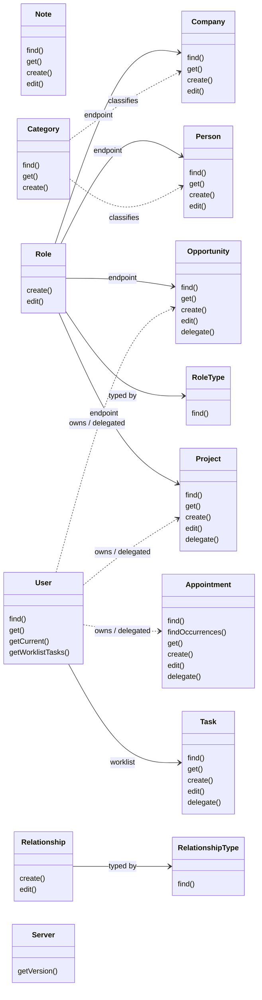

# Daylite MCP Tools

Map of the Daylite MCP server's tools: which objects exist and which verbs apply to each. Generated 2026-11-14 from the server's tool list.

## Naming: why `daylite-` on some tools

Prefixed: `daylite-task`, `daylite-category`, `daylite-user`, `daylite-worklist-tasks`, `daylite-server-version`.

Unprefixed: `person`, `company`, `project`, `opportunity`, `appointment`, `note`, `role`, `relationship`.

Likely reason (inferred, not documented by the server): the prefixed nouns are generic words that collide with other tools in an agent's tool list (e.g. Claude Code's built-in task tools, or "user"/"category" in any other MCP server). CRM-specific nouns are unlikely to collide, so they stay bare.

## Class diagram

Notes:

- `link-daylite-records` is cross-cutting (any record to any record), so it is not drawn per class.
- Role endpoints are taken from the create-company schema (`projectRoles`, `opportunityRoles`) plus person-company roles. Relationship endpoints are not shown because the schema wasn't inspected.
- Nothing can be deleted or unlinked through the MCP.

## Grid: objects × verbs

| Object                 | Find | Get | Create | Edit | Delegate | Other                    |
|------------------------|------|-----|--------|------|----------|--------------------------|
| Person                 | ✓    | ✓   | ✓      | ✓    |          |                          |
| Company                | ✓    | ✓   | ✓      | ✓    |          |                          |
| Project                | ✓    | ✓   | ✓      | ✓    | ✓        |                          |
| Opportunity            | ✓    | ✓   | ✓      | ✓    | ✓        |                          |
| Task (`daylite-`)      | ✓    | ✓   | ✓      | ✓    | ✓        |                          |
| Appointment            | ✓    | ✓   | ✓      | ✓    | ✓        | find occurrences         |
| Note                   | ✓    | ✓   | ✓      | ✓    |          |                          |
| Category (`daylite-`)  | ✓    | ✓   | ✓      |      |          |                          |
| User (`daylite-`)      | ✓    | ✓   |        |      |          | get current, worklist    |
| Role                   |      |     | ✓      | ✓    |          |                          |
| Role type              | ✓    |     |        |      |          |                          |
| Relationship           |      |     | ✓      | ✓    |          |                          |
| Relationship type      | ✓    |     |        |      |          |                          |
| Server                 |      |     |        |      |          | get version              |
| Any record → any       |      |     |        |      |          | link (add only)          |

Gaps worth noting:

- No delete for anything.
- No way to set or edit a note's body. `create-note` and `edit-note` take title, owner, category, dates, and link IDs only. Raised with Marketcircle (Daylite vendor). Opened 2026-11-19. Tracked as Daylite project `8028` ("Feature Request - Edit note body via MCP"); read it with `get-project` `id=8028`.
- No smart lists, groups, keywords, or pipelines.
- Roles and relationships have no Find/Get; read them via the linked records' collections.
